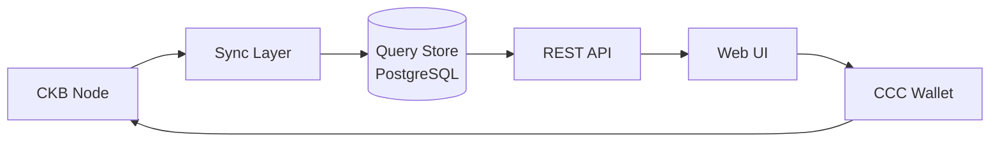
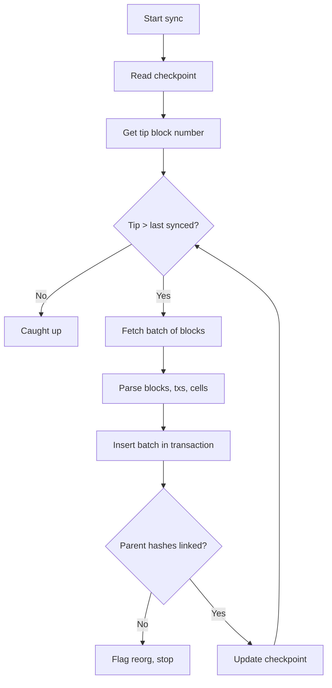

# Proposed Architecture

This is the proposed design for CKScope. It is a plan, not a description of released software.

## High-level pipeline



**Layers:**
| Layer | Role |
|-------|------|
| CKB Node | Source of truth for chain state; exposes JSON-RPC and local RocksDB. |
| Sync Layer | Consumes blocks, normalizes them, and writes to the store with checkpointed progress. |
| Query Store | Database optimized for explorer reads (blocks, transactions, cells). |
| REST API | Typed, paginated read API over the store. |
| Web UI | React interface: block list, block detail, transaction detail. |
| CCC Wallet | In-browser wallet connector for future transaction building. |

## Proposed repository layout

A monorepo with three packages so the API contract can be shared between backend and frontend.

```text
ckscope/
├── package.json                 # npm workspaces
├── docker-compose.yml           # PostgreSQL for local dev
├── packages/
│   ├── backend/                 # API + sync layer
│   │   └── src/
│   │       ├── api/             # REST routers
│   │       ├── db/              # schema, connection, queries
│   │       ├── sync/            # sync engine
│   │       └── scripts/         # migrate, sync runners
│   ├── frontend/                # React UI
│   │   └── src/
│   │       ├── pages/           # block list, detail pages
│   │       ├── components/      # reusable UI pieces
│   │       └── hooks/           # data fetching hooks
│   └── shared/                  # shared TypeScript types
└── docs/                        # design documentation
```

## Sync strategy (proposed)



Key properties:
- A single **checkpoint** row makes sync incremental and resumable (no full re-scan).
- Blocks are fetched in **batches** and inserted atomically.
- A **parent-hash guard** detects chain reorgs.
- Later, batch sizes grow and a RocksDB sidecar replaces RPC fetching.

## Full sync direction

For complete chain sync, the proposed path is to read the node's **RocksDB directly** via a small sidecar, which is expected to be far faster than JSON-RPC. This is a later phase and is not part of initial validation.
