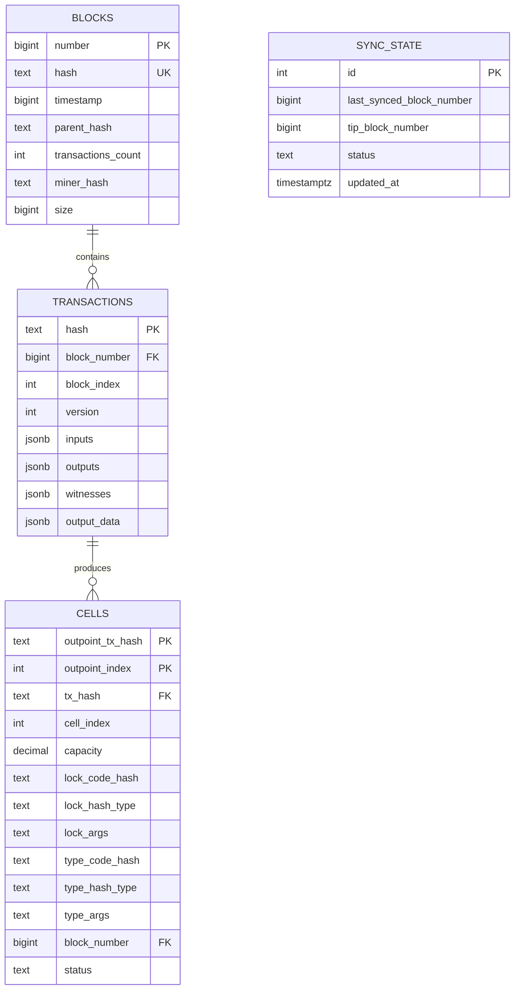

# Proposed Data Model

This is the proposed query-store schema. It is a design proposal, not a description of released software.

## Entities

## Design decisions

| Decision | Rationale |
|----------|-----------|
| `inputs`, `outputs`, `witnesses`, `output_data` as JSONB | Flexible; the schema survives CKB upgrades. |
| `cells` denormalized from outputs | Queried independently of transactions, keeping explorer reads fast. |
| `capacity` as DECIMAL(40,0) | CKB capacities are u64 shannons; no precision loss. |
| Hashes as TEXT | Readable hex strings, index-friendly. |
| `sync_state` singleton | A single checkpoint for incremental, resumable sync. |
| `cells.status` (live / consumed) | Future-proofing for address/balance views. |

## Proposed indexes

- `blocks(number DESC)` — newest-first list queries
- `transactions(block_number, block_index)` — transactions within a block
- `transactions(hash)` — transaction lookup
- `cells(lock_code_hash)` — address-style lookups
- `cells(block_number)` — cells by block
- `cells(tx_hash)` — cells produced by a transaction
