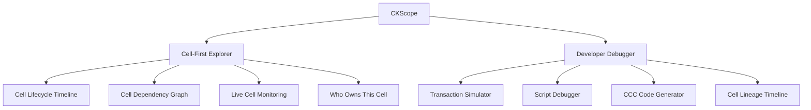
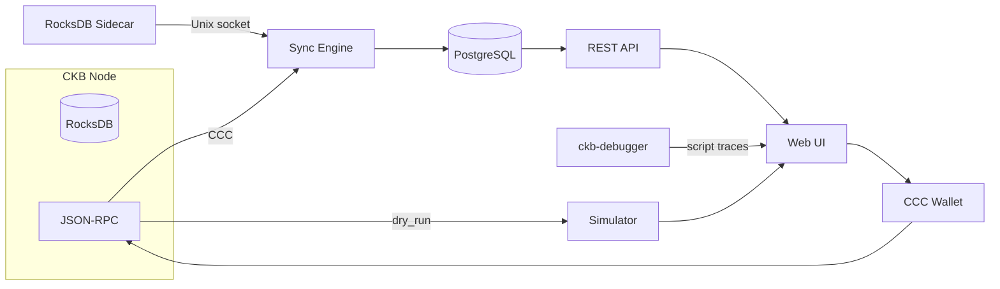
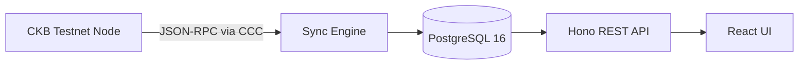
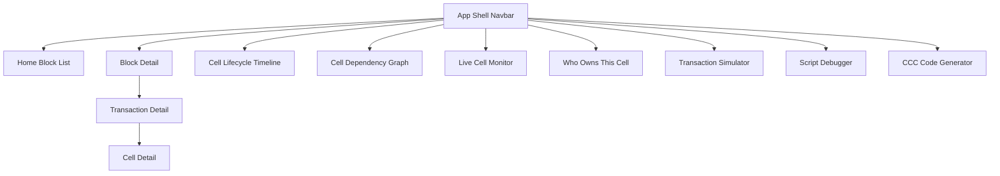
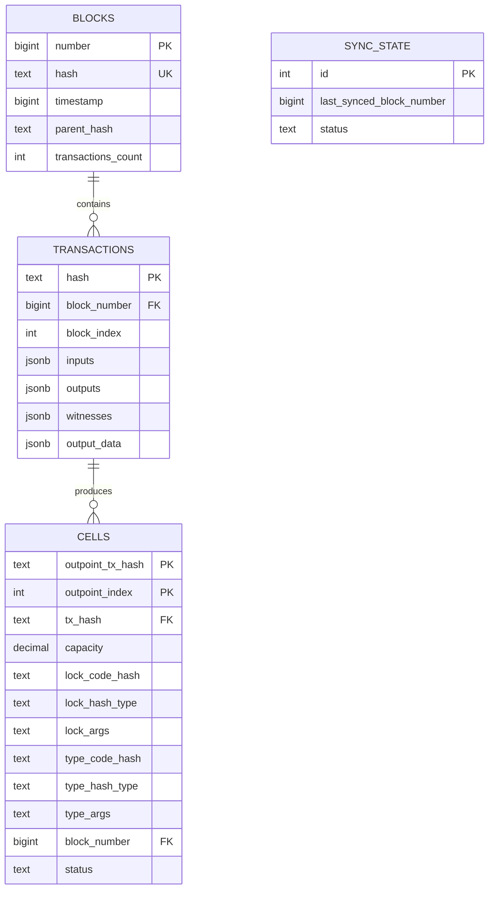
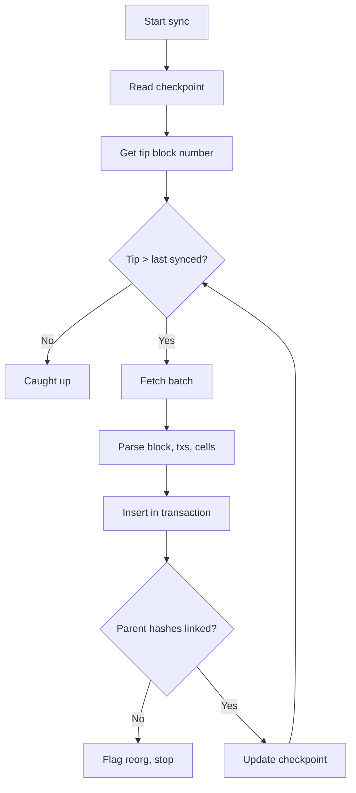
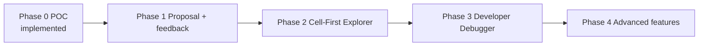

# CKScope — Architecture Overview

**Scope:** The full CKScope product — a **developer's workbench** for CKB. The POC foundation (a working explorer loop) is implemented and verified against live testnet data; the Cell-First Explorer and Developer Debugger directions are the planned main project.

---

## 1. Product Vision

CKScope is a **local-first CKB explorer that doubles as a developer's workbench**. It combines:

- **Cell lifecycle visualization** — understand every cell from creation to consumption
- **Transaction simulation** — test scripts without broadcasting
- **CCC code generation** — reproduce any transaction in TypeScript
- **Explorer fundamentals** — blocks, transactions, and cells through a fast UI

The core pipeline stays the same across the whole product:

```
CKB Node → Sync → Query Store → REST API → Web UI
```

---

## 2. Product Directions

CKScope is built around two complementary directions.

### Direction 1 — Cell-First Explorer

The definitive tool for understanding CKB's **Cell model** — cells as first-class citizens, not just transaction details.

### Direction 2 — Developer Debugger

The essential tool for CKB **contract developers** — simulate, debug, and reproduce scripts.



---

## 3. Feature Catalog

### Direction 1 — Cell-First Explorer

| # | Feature | What it does | Dependency |
|---|---------|--------------|------------|
| F1 | **Full Cell Lifecycle Timeline** | Every event in a cell's existence: created → updated → spent, with data snapshots | Cell consumption tracking |
| F2 | **Cell Dependency Graph** | Visualize Cell → Transaction → Cell relationships; click-through navigation | Full data model + graph rendering |
| F3 | **Live Cell Monitoring** | Watch a cell or address; real-time feed when spent or funded; optional notifications | Subscription / polling |
| F4 | **Who Owns This Cell?** | Resolve a lock script to an address or identity; owned-cell summary | Lock resolution + identity cache |

### Direction 2 — Developer Debugger

| # | Feature | What it does | Dependency |
|---|---------|--------------|------------|
| F5 | **Transaction Simulator** | Paste a raw tx, dry-run against current state, see cycles/errors/warnings | Node `dry_run` RPC |
| F6 | **Script Debugger Integration** | Step through script execution; inspect registers and memory | ckb-debugger |
| F7 | **CCC Code Generator** | Generate exact TypeScript to reproduce any viewed transaction | Client-side, no backend dep |
| F8 | **Cell Lineage Timeline** | Dev-focused cell timeline with script execution info and cycles | Cell lifecycle + script traces |

---

## 4. System Architecture

### 4.1 Target (full product)



### 4.2 Implemented foundation (POC)



The POC proves: real block sync, incremental checkpointing, a typed REST API with cursor pagination, and block/transaction detail pages — all against live data.

---

## 5. Page Structure

The main project introduces new pages beyond the explorer core.



| Area | Pages |
|------|-------|
| Explorer core | Block list, block detail, transaction detail, cell detail, address |
| Cell-first | Cell lifecycle timeline, cell dependency graph, live monitor, ownership resolution |
| Developer | Transaction simulator, script debugger, CCC code generator |
| Cross-cutting | Search, sync status, wallet |

---

## 6. Data Model

### 6.1 Core (implemented in the POC)



### 6.2 Extensions required for the full product

| Extension | Enables | Shape |
|-----------|---------|-------|
| **Consumption tracking** | Cell lifecycle, lineage, spent events | `cells.consumed_by_tx`, `cells.consumed_at_block`; or a `cell_events` table |
| **Data snapshots** | Cell data history in the timeline | `cell_data_history` keyed by outpoint + block |
| **Address / identity cache** | "Who owns this cell?", owned-cell summaries | `addresses` derived from lock args; cached resolution |
| **Watch list / subscriptions** | Live cell monitoring | `watches` (address or outpoint) + event feed |
| **Lineage edges** | Dependency graph | `cell_lineage` parent → child links through txs |

These extend the existing schema rather than replacing it — the JSONB approach keeps the core stable.

---

## 7. Sync Engine

The foundation (implemented) is a checkpointed, batched sync:



**Extensions for the full product:**
- **Consumption pass** — mark cells as consumed and record `consumed_by` for lifecycle/lineage features
- **Live feed** — watch new blocks (poll or WebSocket) to drive live monitoring and subscriptions
- **RocksDB sidecar** — replace RPC fetching for full-chain speed
- **Reorg rollback** — detect and roll back on reorg instead of halting

---

## 8. REST API

Core endpoints (implemented):

| Method | Path | Purpose |
|--------|------|---------|
| `GET` | `/api/blocks` | Paginated block list |
| `GET` | `/api/blocks/:number` | Block detail |
| `GET` | `/api/blocks/:number/transactions` | Txs in a block |
| `GET` | `/api/transactions/:hash` | Transaction detail |
| `GET` | `/api/sync/status` | Sync state |

Planned endpoints (full product):

| Method | Path | Purpose |
|--------|------|---------|
| `GET` | `/api/cells` | Filtered cell query |
| `GET` | `/api/cells/:outpoint` | Cell detail + lifecycle |
| `GET` | `/api/address/:lock_hash/cells` | Cells for an address |
| `GET` | `/api/address/:lock_hash/identity` | Ownership resolution |
| `GET` | `/api/cells/:outpoint/timeline` | Lifecycle timeline |
| `GET` | `/api/cells/:outpoint/lineage` | Dependency graph |
| `POST` | `/api/watch` | Create a watch (live monitoring) |
| `POST` | `/api/simulate` | Dry-run a raw transaction |
| `GET` | `/api/search` | Smart search |

All responses keep the `{ data, pagination?, error? }` envelope.

---

## 9. Build Phases



| Phase | Focus | Key features |
|-------|-------|--------------|
| **0 — POC** (done) | Prove the core loop | Real sync, PostgreSQL, API, basic UI |
| **1 — Proposal** | Package + community feedback | Screenshots, grant proposal, forum posts |
| **2 — Cell-First Explorer** | Cell lifecycle + ownership | F1 timeline, F4 resolution |
| **3 — Developer Debugger** | Simulate + generate | F5 simulator, F7 CCC code generator |
| **4 — Advanced** | Graphs, live, debug | F2 graph, F3 live monitor, F6 script debugger, F8 lineage |

---

## 10. Technology Stack

| Layer | Technology |
|-------|-----------|
| Runtime | Node.js 20+ |
| CKB client | `@ckb-ccc/core` |
| Backend | Hono + Kysely |
| Database | PostgreSQL 16 |
| Frontend | React 18 + Vite + Tailwind + TanStack Query |
| Simulator | CKB node `dry_run` RPC |
| Script debugger | ckb-debugger |
| Graph rendering | graph visualization library |
| Sidecar (later) | Rust + ckb-types + rust-rocksdb |
| Wallet | CCC connector |
