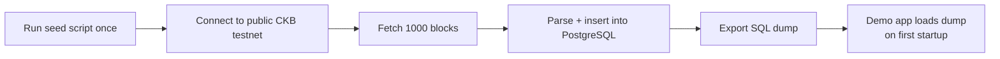
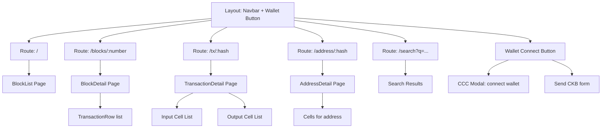
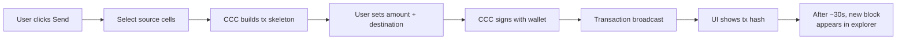

# CKScope — Grant Demo Architecture Plan

## Overview

CKScope is a local-first CKB explorer. This document describes the **grant demo** architecture — a polished, working prototype that demonstrates the vision using pre-seeded data, with a clear upgrade path to the full production system (direct RocksDB reads) described in the grant proposal.

---

## Product Vision

CKScope is a **developer's workbench** for CKB — a local-first explorer that combines cell lifecycle visualization, transaction simulation, and CCC code generation. The full product spans two directions:

- **Cell-First Explorer** — cells as first-class citizens: lifecycle timeline, dependency graph, live cell monitoring, ownership resolution.
- **Developer Debugger** — simulate, debug, and reproduce: transaction simulator, script debugger, CCC code generator, dev cell-lineage timeline.

The grant demo below is the first polished, public surface of this vision. It focuses on the explorer core (blocks, transactions, cells) as the foundation; the Cell-First and Developer features build on that same architecture. The full feature catalog, page structure, and data-model extensions are documented in [`docs/research/architecture.md`](../docs/research/architecture.md).

---

## 1. Project Structure

```
ckscope/
├── package.json                    # Root: npm workspaces
├── docker-compose.yml              # PostgreSQL for local dev
├── README.md                       # Project overview + grant pitch
│
├── packages/
│   ├── backend/
│   │   ├── package.json
│   │   ├── tsconfig.json
│   │   ├── src/
│   │   │   ├── index.ts            # Express app entry
│   │   │   ├── db/
│   │   │   │   ├── schema.sql      # PostgreSQL DDL (source of truth)
│   │   │   │   ├── migrations/     # node-pg-migrate files
│   │   │   │   ├── pool.ts         # pg-pool connection
│   │   │   │   └── queries/        # Type-safe query functions
│   │   │   │       ├── blocks.ts
│   │   │   │       ├── transactions.ts
│   │   │   │       └── cells.ts
│   │   │   ├── api/
│   │   │   │   ├── router.ts       # Express router
│   │   │   │   ├── blocks.ts       # GET /api/blocks, /api/blocks/:number
│   │   │   │   ├── transactions.ts # GET /api/transactions/:hash
│   │   │   │   ├── cells.ts        # GET /api/cells, /api/address/:hash/cells
│   │   │   │   ├── search.ts       # GET /api/search?q=...
│   │   │   │   └── sync.ts         # GET /api/sync/status
│   │   │   ├── sync/
│   │   │   │   ├── engine.ts       # Sync engine (stub for demo)
│   │   │   │   └── types.ts
│   │   │   └── seed/
│   │   │       └── seed.ts         # One-time data seeder from JSON-RPC
│   │   └── data/
│   │       └── seed-dump.sql       # Pre-seeded PostgreSQL dump
│   │
│   ├── frontend/
│   │   ├── package.json
│   │   ├── tsconfig.json
│   │   ├── vite.config.ts
│   │   ├── index.html
│   │   ├── src/
│   │   │   ├── main.tsx
│   │   │   ├── App.tsx
│   │   │   ├── pages/
│   │   │   │   ├── BlockList.tsx       # /blocks
│   │   │   │   ├── BlockDetail.tsx     # /blocks/:number
│   │   │   │   ├── TransactionDetail.tsx # /tx/:hash
│   │   │   │   ├── AddressDetail.tsx   # /address/:hash
│   │   │   │   └── Search.tsx          # /search?q=...
│   │   │   ├── components/
│   │   │   │   ├── Layout.tsx          # Navbar, sidebar
│   │   │   │   ├── BlockCard.tsx
│   │   │   │   ├── TransactionRow.tsx
│   │   │   │   ├── CellCard.tsx
│   │   │   │   ├── ScriptDisplay.tsx   # Lock/type script renderer
│   │   │   │   ├── Pagination.tsx
│   │   │   │   └── WalletConnect.tsx   # CCC connector button
│   │   │   ├── hooks/
│   │   │   │   ├── useBlocks.ts
│   │   │   │   ├── useTransaction.ts
│   │   │   │   ├── useCells.ts
│   │   │   │   └── useSearch.ts
│   │   │   ├── utils/
│   │   │   │   ├── api.ts             # Fetch wrapper
│   │   │   │   └── formatters.ts      # CKB-specific formatting
│   │   │   └── types/
│   │   │       └── index.ts           # Shared types (mirrors shared pkg)
│   │   └── .env.example
│   │
│   └── shared/
│       ├── package.json
│       ├── tsconfig.json
│       └── src/
│           └── types/
│               ├── block.ts
│               ├── transaction.ts
│               ├── cell.ts
│               └── api.ts            # API response types
│
└── scripts/
    └── seed-from-rpc.ts               # One-time data fetcher
```

---

## 2. Data Model

### PostgreSQL Schema

```sql
-- Sync state (singleton)
CREATE TABLE sync_state (
    id INTEGER PRIMARY KEY DEFAULT 1 CHECK (id = 1),
    last_synced_block_number BIGINT NOT NULL DEFAULT 0,
    last_synced_block_hash TEXT,
    tip_block_number BIGINT NOT NULL DEFAULT 0,
    tip_block_hash TEXT,
    status TEXT NOT NULL DEFAULT 'seeded',  -- seeded | syncing | caught_up
    total_blocks BIGINT NOT NULL DEFAULT 0,
    updated_at TIMESTAMPTZ DEFAULT NOW()
);

-- Blocks
CREATE TABLE blocks (
    number BIGINT PRIMARY KEY,
    hash TEXT UNIQUE NOT NULL,
    timestamp BIGINT NOT NULL,
    parent_hash TEXT NOT NULL,
    transactions_count INT NOT NULL DEFAULT 0,
    miner_hash TEXT,
    difficulty TEXT,
    size BIGINT
);
CREATE INDEX idx_blocks_number_desc ON blocks(number DESC);

-- Transactions
CREATE TABLE transactions (
    hash TEXT PRIMARY KEY,
    block_number BIGINT NOT NULL REFERENCES blocks(number),
    block_index INT NOT NULL,
    version INT NOT NULL DEFAULT 0,
    cell_deps JSONB,        -- Flexible: array of cell deps
    header_deps JSONB,      -- Flexible: array of header deps
    inputs JSONB,           -- Flexible: array of inputs
    outputs JSONB,          -- Flexible: array of outputs
    witnesses JSONB,        -- Flexible: array of witnesses
    output_data JSONB       -- Flexible: array of hex-encoded data
);
CREATE INDEX idx_tx_block_number ON transactions(block_number, block_index);
CREATE INDEX idx_tx_block_hash ON transactions(hash);

-- Cells (denormalized from transaction outputs for fast querying)
CREATE TABLE cells (
    outpoint_tx_hash TEXT NOT NULL,
    outpoint_index INT NOT NULL,
    tx_hash TEXT NOT NULL REFERENCES transactions(hash),
    cell_index INT NOT NULL,
    capacity DECIMAL(40,0) NOT NULL,
    lock_code_hash TEXT,
    lock_hash_type TEXT,
    lock_args TEXT,
    type_code_hash TEXT,
    type_hash_type TEXT,
    type_args TEXT,
    data_hash TEXT,
    data_size BIGINT,
    block_number BIGINT NOT NULL REFERENCES blocks(number),
    status TEXT NOT NULL DEFAULT 'live',  -- live | consumed
    PRIMARY KEY (outpoint_tx_hash, outpoint_index)
);

-- Critical indexes for explorer queries
CREATE INDEX idx_cells_lock_code_hash ON cells(lock_code_hash);
CREATE INDEX idx_cells_lock_args ON cells(lock_args);
CREATE INDEX idx_cells_type_code_hash ON cells(type_code_hash);
CREATE INDEX idx_cells_block_number ON cells(block_number);
CREATE INDEX idx_cells_status ON cells(status);
CREATE INDEX idx_cells_tx_hash ON cells(tx_hash);
```

### Key Design Decisions

| Decision | Rationale |
|----------|-----------|
| `inputs` and `outputs` as **JSONB** | Molecule-deserialized but stored flexibly; schema doesn't break on CKB upgrades |
| `cells` table is **denormalized** | Queried independently from transactions — this is what makes the explorer fast |
| `capacity` as **DECIMAL(40,0)** | CKB capacities are u64 (up to 18M CKB = 18,000,000,000,000,000 shannons); fits in DECIMAL |
| All hashes as **TEXT** | Hex strings are easier to debug in the database; indexing works fine |
| No foreign key cascade deletes | Blocks are never deleted in the demo; in production, reorgs handle deletion explicitly |

---

## 3. Data Seeding Strategy

### How the demo gets data

Instead of a live sync engine, the demo uses a **one-time seed script** that fetches data from CKB's public testnet JSON-RPC:



**Seed script flow:**

```
seed-from-rpc.ts
  │
  ├─ 1. Get tip block number from testnet RPC
  ├─ 2. Calculate start = tip - 1000
  ├─ 3. Loop in batches of 50:
  │    ├─ Fetch 50 blocks in parallel via Promise.all
  │    ├─ Parse each block:
  │    │    ├─ Extract block header → blocks table
  │    │    ├─ Extract each tx → transactions table
  │    │    └─ Extract each output → cells table
  │    └─ Bulk INSERT all 50 blocks in one transaction
  ├─ 4. Update sync_state row
  └─ 5. Done — database has 1000 live blocks
```

**Why 1000 blocks?**
- Enough to demonstrate pagination, search, and navigation
- Small enough to seed in ~30 seconds via JSON-RPC
- The demo feels "real" without being overwhelming

**Important:** This seed script is a **development tool**, not part of the running application. The demo app ships with the SQL dump and never connects to a CKB node.

---

## 4. REST API Design

### Endpoints

| Method | Path | Query Params | Response | Purpose |
|--------|------|-------------|----------|---------|
| `GET` | `/api/blocks` | `?cursor=&limit=20` | `{data: Block[], pagination: {next_cursor, has_more}}` | Paginated block list (newest first) |
| `GET` | `/api/blocks/:number` | — | `{data: Block}` | Single block with summary |
| `GET` | `/api/blocks/:number/transactions` | `?cursor=&limit=20` | `{data: Transaction[], pagination}` | Transactions in a block |
| `GET` | `/api/transactions/:hash` | — | `{data: Transaction}` | Full transaction detail |
| `GET` | `/api/cells` | `?lock_code_hash=&type_code_hash=&status=live&cursor=&limit=20` | `{data: Cell[], pagination}` | Filtered cell query |
| `GET` | `/api/cells/:outpoint_tx_hash/:outpoint_index` | — | `{data: Cell}` | Single cell detail |
| `GET` | `/api/address/:lock_hash/cells` | `?status=live&cursor=&limit=20` | `{data: Cell[], pagination}` | All cells for a lock hash |
| `GET` | `/api/search` | `?q=` | `{data: SearchResult}` | Smart search |
| `GET` | `/api/sync/status` | — | `{data: SyncStatus}` | Sync state (always "seeded" in demo) |

### Response Envelope

```typescript
// All responses follow this shape
interface ApiResponse<T> {
  data: T;
  pagination?: {
    next_cursor: string | null;  // Opaque cursor for next page
    has_more: boolean;
  };
  error?: {
    code: string;
    message: string;
  };
}
```

### Cursor-Based Pagination

```sql
-- Instead of: SELECT * FROM blocks ORDER BY number DESC LIMIT 20 OFFSET 40
-- Use cursor:
SELECT * FROM blocks
WHERE number < :cursor
ORDER BY number DESC
LIMIT 20;
```

Cursor is the last block number from the previous page, URL-safe base64 encoded.

---

## 5. Frontend Architecture

### Page Structure



### State Management

Use **TanStack Query (React Query)** for all data fetching:

```typescript
// Example hook
function useBlocks(cursor?: string) {
  return useQuery({
    queryKey: ['blocks', cursor],
    queryFn: () => api.get(`/api/blocks?cursor=${cursor ?? ''}`),
    staleTime: 30_000,  // 30s — data doesn't change in demo
  });
}
```

This gives you caching, pagination state management, and loading states for free.

### Key Components

| Component | Purpose | Notes |
|-----------|---------|-------|
| `Layout.tsx` | Shell: navbar, breadcrumbs, wallet button | Persistent across routes |
| `BlockCard.tsx` | Block summary in list | Number, hash, tx count, age |
| `TransactionRow.tsx` | Tx summary row | Hash, inputs/outputs count, age |
| `CellCard.tsx` | Cell visualization | Capacity, lock/type scripts, data preview |
| `ScriptDisplay.tsx` | Lock/type script renderer | Code hash, hash type, args — with copy buttons |
| `WalletConnect.tsx` | CCC wallet connector | Connect/disconnect, selected address |

### Pages

**BlockList** (`/`)
- Cards showing recent blocks
- Pagination at bottom
- Auto-refresh (optional, since data is static)

**BlockDetail** (`/blocks/:number`)
- Header fields (number, hash, timestamp, parent hash, miner)
- Transaction list with pagination
- Link to each transaction detail

**TransactionDetail** (`/tx/:hash`)
- Full tx metadata (version, cell deps, header deps)
- Inputs: list of consumed outpoints
- Outputs: list of created cells (with script display)
- Witnesses: raw data display

**AddressDetail** (`/address/:lock_hash`)
- All cells matching a lock hash
- Filter: live vs consumed
- Capacity summary (total live CKB)

**Search** (`/search?q=...`)
- Auto-detect input type:
  - 66-char hex → transaction hash lookup
  - Numeric → block number lookup
  - Otherwise → address/cell search

---

## 6. CCC Wallet Integration

### What CCC Provides

```typescript
import { createConnector, useSigner } from '@ckb-ccc/connector-react';

// In App.tsx — wrap the app
<ConnectorProvider>
  <App />
</ConnectorProvider>

// In WalletConnect.tsx — connect button
function WalletButton() {
  const { connect, disconnect, isConnected } = useConnector();
  const signer = useSigner();
  
  return <button onClick={isConnected ? disconnect : connect}>
    {isConnected ? signer?.address : 'Connect Wallet'}
  </button>;
}
```

### Demo Wallet Features

| Feature | Implementation | Demo Scope |
|---------|---------------|------------|
| Connect wallet | `@ckb-ccc/connector-react` | Works with any CCC-compatible wallet |
| Show address | `signer.getAddress()` | Display in navbar |
| Show balance | `rpc.getBalance(address)` | Fetch live balance |
| Send CKB | `signer.buildTransaction()` + `signer.signAndSendTransaction()` | Simple send form |
| Cell explorer integration | Click a cell → "Send from this cell" | Demonstrates the workflow |

### Transaction Building Flow



For the demo, the send flow works against **live CKB testnet** via CCC — this is real functionality, not simulated.

---

## 7. What the Grant Proposal Describes

The grant proposal document pitches the **full system**, which includes everything the demo has PLUS:

### Phase 2 (Grant-Funded)

```
1. RocksDB Reader Sidecar
   - Small Rust binary using ckb-types crate
   - Reads CKB node's RocksDB directly via rust-rocksdb
   - Exposes blocks over Unix socket to Node.js process
   - 100-1000x faster than JSON-RPC sync

2. Incremental Sync Engine
   - Batch processing (500 blocks per transaction)
   - Reorg detection via parent_hash comparison
   - Crash recovery via sync_state singleton
   - Concurrent batch writes to PostgreSQL

3. Production Readiness
   - Docker compose with CKB node + CKScope
   - Health checks and monitoring
   - Performance benchmarks vs. JSON-RPC explorers
```

---

## 8. Build Sequence

The order matters — build in this sequence to minimize dependencies:

```
Step 1: Project scaffolding
  - Monorepo with npm workspaces
  - TypeScript configs
  - Docker compose for PostgreSQL
  └── Outcome: Project boots, DB connects

Step 2: Shared types
  - Block, Transaction, Cell, API response types
  └── Outcome: Types exist for both packages

Step 3: Database schema + migrations
  - SQL DDL
  - node-pg-migrate setup
  └── Outcome: Tables exist in PostgreSQL

Step 4: Data seeding
  - seed-from-rpc.ts script
  - Export seed-dump.sql
  └── Outcome: Database has 1000 real blocks

Step 5: Backend API
  - Express server
  - All 9 endpoints with cursor pagination
  └── Outcome: API returns real data

Step 6: Frontend pages
  - React + Vite + React Router
  - All 5 pages
  └── Outcome: Working web app

Step 7: CCC wallet integration
  - WalletConnect component
  - Send CKB form
  └── Outcome: Wallet works

Step 8: Polish + grant docs
  - README with architecture diagrams
  - Grant proposal section
  - Demo video script
  └── Outcome: Ready to submit
```

---

## 9. Technology Stack Summary

| Layer | Technology | Why |
|-------|-----------|-----|
| Runtime | **Node.js 22+** | Modern JS, stable |
| Language | **TypeScript** | Type safety across full stack |
| Backend framework | **Hono** | Lightweight, excellent TypeScript DX, URL pattern matching |
| ORM/Query builder | **Kysely** | Type-safe SQL builder, zero magic |
| Migrations | **node-pg-migrate** | Simple file-based migrations |
| PostgreSQL client | **pg** + **pg-pool** | Standard, battle-tested |
| Frontend framework | **React 18 + Vite** | Fast builds, broad ecosystem |
| Routing | **React Router v6** | Standard React routing |
| Data fetching | **TanStack Query** | Caching, pagination, loading/error states |
| CSS framework | **Tailwind CSS** | Maximum design control for custom UI |
| Wallet | **@ckb-ccc/connector-react** | CCC standard |
| Containerization | **Docker Compose** | PostgreSQL only |
| Package manager | **npm workspaces** | User preference, built-in monorepo support |

## 10. Frontend Design Guidelines

### Design Target
The UI should match or exceed CKBadger's quality. Based on the CKBadger forum post, the design approach:

- **Dark theme** with accent colors for data types (blocks, transactions, cells)
- **Card-based layout** — each block/transaction/cell rendered as a distinct card with clear visual hierarchy
- **Minimalist navigation** — top navbar with search bar, no sidebar clutter
- **Data density** — show key info at a glance, expand for details
- **Cell visualization** — lock script and type script displayed as structured, collapsible sections

### Color Palette (Tailwind)

```
Background:    gray-950 (#0a0a0a)
Cards:         gray-900 (#111111)
Card border:   gray-800 (#1f1f1f)
Text primary:  gray-100 (#f5f5f5)
Text muted:    gray-400 (#9ca3af)
Accent blocks: blue-500 (#3b82f6)
Accent txs:    emerald-500 (#10b981)
Accent cells:  amber-500 (#f59e0b)
Danger:        red-500 (#ef4444)
Links:         cyan-400 (#22d3ee)
```

### Component Design Specs

| Component | Layout | Key Elements |
|-----------|--------|-------------|
| **BlockCard** | Horizontal card | Number (large), hash (truncated), tx count badge, timestamp, age |
| **TransactionRow** | Compact row | Hash (truncated), input/output count icons, CKB amount |
| **CellCard** | Vertical card | Capacity (prominent), lock script (expandable), type script (expandable), data preview |
| **ScriptDisplay** | Structured block | CodeHash (mono, copyable), HashType badge, Args (truncated with expand) |
| **SearchBar** | Prominent top bar | Full-width input, auto-detect hash vs number vs address |
| **Pagination** | Bottom center | Previous/Next buttons with cursor, page info |
| **WalletButton** | Top-right navbar | Connect/disconnect, truncated address, balance tooltip |

### Page Layouts

```
BlockList Page:
┌─────────────────────────────────────────────┐
│  🔍 [Search blocks, txs, addresses...]      │
│  ┌─────────────────────────────────────────┐│
│  │ #1843500  ──  12 txs  ──  2m ago       ││
│  │ 0xabcd...ef01                           ││
│  ├─────────────────────────────────────────┤│
│  │ #1843499  ──  8 txs   ──  5m ago       ││
│  │ 0x1234...5678                           ││
│  └─────────────────────────────────────────┘│
│  [← Previous]                    [Next →]   │
└─────────────────────────────────────────────┘

BlockDetail Page:
┌─────────────────────────────────────────────┐
│  Block #1843500                              │
│  ┌─ Header ───────────────────────────────┐ │
│  │ Hash:    0xabcd...ef01                  │ │
│  │ Parent:  0x9876...fedc  [↗]            │ │
│  │ Time:    2026-07-25 19:00:00 UTC        │ │
│  │ Txs:     12                             │ │
│  └─────────────────────────────────────────┘ │
│  ┌─ Transactions ──────────────────────────┐ │
│  │ 0xaaa...bbb  ⤵ 5 in  ⤴ 3 out  450 CKB  │ │
│  │ 0xccc...ddd  ⤵ 2 in  ⤴ 5 out  1200 CKB │ │
│  │ ...                                       │ │
│  └─────────────────────────────────────────┘ │
└─────────────────────────────────────────────┘

TransactionDetail Page:
┌─────────────────────────────────────────────┐
│  Transaction 0xaaa...bbb                     │
│  ┌─ Meta ─────────────────────────────────┐ │
│  │ Block:  #1843500  [↗]                  │ │
│  │ Index:  3                               │ │
│  │ Version: 0                              │ │
│  └─────────────────────────────────────────┘ │
│  ┌─ Inputs (2) ───────────────────────────┐ │
│  │ 📄 Cell from 0x111...222 :3  [↗]       │ │
│  │ 📄 Cell from 0x333...444 :1  [↗]       │ │
│  └─────────────────────────────────────────┘ │
│  ┌─ Outputs (3) ──────────────────────────┐ │
│  │ 📦 450 CKB  Lock: secp256k1...         │ │
│  │ 📦 200 CKB  Lock: secp256k1...         │ │
│  │ 📦 550 CKB  Lock: ...  Type: UDT...    │ │
│  └─────────────────────────────────────────┘ │
└─────────────────────────────────────────────┘
```

### Mobile Responsiveness
- Cards stack vertically on small screens
- Tables switch to stacked card layout below 768px
- Search bar collapses to icon-only on mobile
- Pagination becomes "Load More" button on mobile
