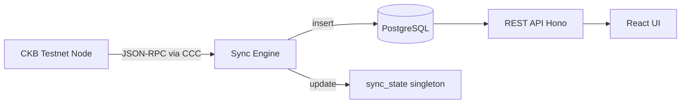
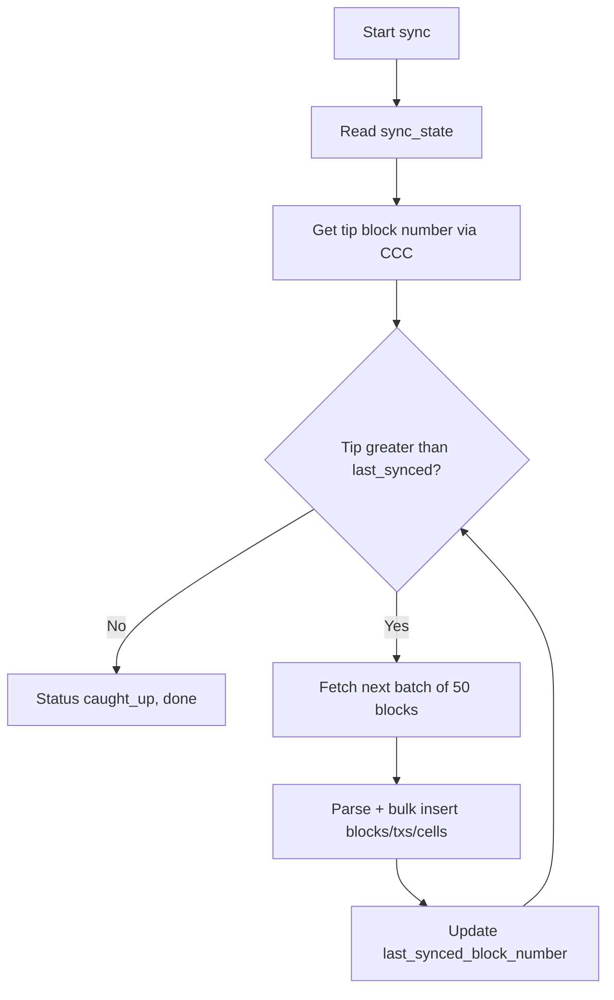
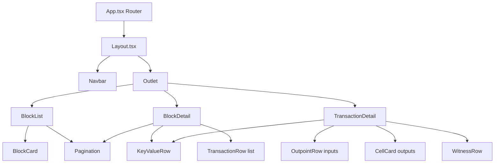
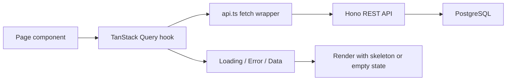

# CKScope — POC Plan (v1)

**Status:** Draft for review
**Scope:** Minimal working POC to prove architecture viability before grant proposal.

---

## 1. Goal

Build a small, working POC that connects to a CKB testnet node via **CCC**, syncs a window of blocks into **PostgreSQL**, and serves them through a **REST API + React UI**.

This proves the core loop:

```
CKB Node (RPC via CCC) → Sync Engine → PostgreSQL → REST API → React UI
```

The POC is **Phase 0** of the full CKScope vision — a **developer's workbench** for CKB spanning a **Cell-First Explorer** and a **Developer Debugger** (cell lifecycle, dependency graphs, live monitoring, transaction simulation, script debugging, CCC code generation). The full feature catalog and architecture implications are documented in [`docs/research/architecture.md`](../docs/research/architecture.md).

The POC is also the seed for the full grant demo described in [`demo-architecture.md`](demo-architecture.md). It deliberately excludes the advanced features above so we can ship, share on Nervos Talk / Discord, and gather feedback fast — the advanced features build on the exact same architecture the POC proves.

---

## 2. POC Scope

### In scope
| Feature | Notes |
|---------|-------|
| Connect to CKB testnet via CCC client | `@ckb-ccc/core` Client against a public testnet RPC |
| Fetch + parse blocks | Batch fetch from tip backwards, 100 blocks total |
| Store in PostgreSQL | `blocks`, `transactions`, `cells`, `sync_state` tables |
| Incremental re-sync on startup | Picks up where `sync_state` left off |
| REST API | Blocks list/detail, transaction detail, sync status |
| React UI | Block list, block detail, transaction detail |
| Screenshots for community post | Captured at the end |

### Out of scope (post-POC)
- Full-chain indexing (all blocks)
- Direct RocksDB reads (grant Phase 2)
- Search functionality
- Wallet connection / transaction building (CCC)
- Cell visualization

---

## 3. Architecture



**Why this works as a POC:** JSON-RPC via CCC returns fully parsed block/tx JSON — no Molecule decoding needed yet. Molecule decoding only becomes necessary for direct RocksDB reads, which is a post-POC concern.

---

## 4. Tech Stack

| Layer | Technology | Why |
|-------|-----------|-----|
| Runtime | Node.js 22+ | CCC ecosystem is JS/TS |
| Language | TypeScript | Type safety across full stack |
| CKB client | `@ckb-ccc/core` | CCC is the future; Lumos is deprecated |
| Backend framework | Hono | Lightweight, excellent TS DX |
| Query builder | Kysely | Type-safe SQL, zero magic |
| Migrations | node-pg-migrate | File-based migrations |
| PostgreSQL client | pg + pg-pool | Battle-tested |
| Frontend | React 18 + Vite | Fast builds, broad ecosystem |
| Routing | React Router v6 | Standard |
| Data fetching | TanStack Query | Caching + loading states |
| Styling | Tailwind CSS | Dark explorer theme |
| Dev DB | Docker Compose (PostgreSQL) | Local parity with prod |

---

## 5. Project Structure

```
ckscope/
├── package.json                 # npm workspaces
├── docker-compose.yml           # PostgreSQL for local dev
├── README.md                    # Setup + how it works
│
├── packages/
│   ├── backend/
│   │   ├── package.json
│   │   ├── tsconfig.json
│   │   └── src/
│   │       ├── index.ts         # Hono app entry
│   │       ├── db/
│   │       │   ├── schema.sql   # DDL source of truth
│   │       │   ├── migrations/
│   │       │   ├── pool.ts
│   │       │   └── queries/
│   │       │       ├── blocks.ts
│   │       │       ├── transactions.ts
│   │       │       └── cells.ts
│   │       ├── api/
│   │       │   ├── router.ts
│   │       │   ├── blocks.ts
│   │       │   ├── transactions.ts
│   │       │   └── sync.ts
│   │       └── sync/
│   │           ├── engine.ts    # Batch fetch + insert + state update
│   │           └── client.ts    # CCC client creation
│   │
│   ├── frontend/
│   │   ├── package.json
│   │   ├── vite.config.ts
│   │   ├── index.html
│   │   └── src/
│   │       ├── main.tsx
│   │       ├── App.tsx          # Router
│   │       ├── api.ts           # Fetch wrapper
│   │       ├── hooks/           # useBlocks, useBlock, useTransaction
│   │       ├── pages/
│   │       │   ├── BlockList.tsx
│   │       │   ├── BlockDetail.tsx
│   │       │   └── TransactionDetail.tsx
│   │       └── components/
│   │           ├── Layout.tsx
│   │           ├── BlockCard.tsx
│   │           └── TransactionRow.tsx
│   │
│   └── shared/
│       └── src/types/
│           ├── block.ts
│           ├── transaction.ts
│           ├── cell.ts
│           └── api.ts
│
└── scripts/
    └── sync.ts                  # Runs sync engine once (or --watch)
```

---

## 6. Database Schema

### sync_state (singleton)
```sql
CREATE TABLE sync_state (
    id INTEGER PRIMARY KEY DEFAULT 1 CHECK (id = 1),
    last_synced_block_number BIGINT NOT NULL DEFAULT 0,
    tip_block_number BIGINT NOT NULL DEFAULT 0,
    status TEXT NOT NULL DEFAULT 'idle',  -- idle | syncing | caught_up
    updated_at TIMESTAMPTZ DEFAULT NOW()
);
```

### blocks
```sql
CREATE TABLE blocks (
    number BIGINT PRIMARY KEY,
    hash TEXT UNIQUE NOT NULL,
    timestamp BIGINT NOT NULL,
    parent_hash TEXT NOT NULL,
    transactions_count INT NOT NULL DEFAULT 0,
    miner_hash TEXT,
    size BIGINT
);
CREATE INDEX idx_blocks_number_desc ON blocks(number DESC);
```

### transactions
```sql
CREATE TABLE transactions (
    hash TEXT PRIMARY KEY,
    block_number BIGINT NOT NULL REFERENCES blocks(number),
    block_index INT NOT NULL,
    version INT NOT NULL DEFAULT 0,
    inputs JSONB,
    outputs JSONB,
    witnesses JSONB,
    output_data JSONB
);
CREATE INDEX idx_tx_block_number ON transactions(block_number, block_index);
```

### cells (denormalized from tx outputs)
```sql
CREATE TABLE cells (
    outpoint_tx_hash TEXT NOT NULL,
    outpoint_index INT NOT NULL,
    tx_hash TEXT NOT NULL REFERENCES transactions(hash),
    cell_index INT NOT NULL,
    capacity DECIMAL(40,0) NOT NULL,
    lock_code_hash TEXT,
    lock_hash_type TEXT,
    lock_args TEXT,
    type_code_hash TEXT,
    type_hash_type TEXT,
    type_args TEXT,
    block_number BIGINT NOT NULL REFERENCES blocks(number),
    status TEXT NOT NULL DEFAULT 'live',  -- live | consumed
    PRIMARY KEY (outpoint_tx_hash, outpoint_index)
);
CREATE INDEX idx_cells_lock_code_hash ON cells(lock_code_hash);
CREATE INDEX idx_cells_block_number ON cells(block_number);
CREATE INDEX idx_cells_tx_hash ON cells(tx_hash);
```

**Design notes:**
- `inputs`/`outputs`/`witnesses` stored as JSONB — flexible, survives CKB upgrades.
- `cells` denormalized from outputs so future explorer queries stay fast.
- `capacity` as DECIMAL(40,0) — shannons are u64.
- POC does not model consumed cells (no reorg/CKB-URI tracking); `status` is future-proofing.

---

## 7. Sync Strategy

**Answers the "incremental sync" question:** use a single-row `sync_state` checkpoint.



**Batch flow (per run):**
1. Read `last_synced_block_number` from `sync_state`.
2. Fetch tip via `client.getTipHeader()`.
3. First run: backfill window — start from `tip - 100`.
4. Subsequent runs: fetch blocks `last_synced + 1 → tip`.
5. Fetch in batches of 50 with `Promise.all`, parse each block into the 3 tables.
6. Commit each batch in one transaction; update `sync_state` inside the same tx.
7. Reorg handling: POC does a simple `parent_hash` check — if a fetched block's parent doesn't match the stored previous block, stop and flag `status = 'reorg'` (full reorg logic is post-POC).

**Why 100 blocks:** enough to demonstrate list/detail/pagination without long sync times.

---

## 8. REST API (POC subset)

| Method | Path | Query | Response | Purpose |
|--------|------|-------|----------|---------|
| `GET` | `/api/blocks` | `?cursor=&limit=20` | `{data: Block[], pagination}` | Newest-first block list |
| `GET` | `/api/blocks/:number` | — | `{data: Block}` | Single block + summary |
| `GET` | `/api/blocks/:number/transactions` | `?cursor=&limit=20` | `{data: Transaction[], pagination}` | Txs in a block |
| `GET` | `/api/transactions/:hash` | — | `{data: Transaction}` | Full tx detail |
| `GET` | `/api/sync/status` | — | `{data: SyncStatus}` | POC sync state |

**Envelope:** all responses `{ data, pagination?, error? }`.

**Pagination:** cursor-based — `WHERE number < :cursor ORDER BY number DESC LIMIT :limit`, cursor is base64 of the last seen number. Simpler and more stable than OFFSET for a growing table.

---

## 9. React Frontend

### 9.1 Route Map

| Route | Page | Data source hook | Purpose |
|-------|------|------------------|---------|
| `/` | `BlockList` | `useBlocks(cursor)` | Newest-first block cards + pagination |
| `/blocks/:number` | `BlockDetail` | `useBlock(number)` + `useBlockTransactions(number, cursor)` | Header fields + tx rows |
| `/tx/:hash` | `TransactionDetail` | `useTransaction(hash)` | Meta, inputs, outputs, witnesses |
| `*` | `NotFound` | — | 404 fallback with link home |

All routes render inside `Layout` via a nested route (React Router v6 `Outlet`).

### 9.2 Component Tree



### 9.3 Data Flow



**Rules:**
- Pages never call `fetch` directly — all data goes through `api.ts` + typed hooks.
- Each hook owns one query key namespace, e.g. `['blocks', cursor]`, `['block', number]`, `['block-transactions', number, cursor]`, `['tx', hash]`.
- `staleTime: 30_000` and `gcTime: 5 * 60_000` since POC data is static after sync.
- Pagination state lives in the page (via `useSearchParams` or local state), fed into the hook as a query key.

### 9.4 Hooks (`hooks/`)

| Hook | Query key | Returns | Notes |
|------|-----------|---------|-------|
| `useBlocks(cursor?)` | `['blocks', cursor]` | `Block[]`, `nextCursor`, `hasMore` | `staleTime` 30s |
| `useBlock(number)` | `['block', number]` | `Block` | Enabled only when `number` parses |
| `useBlockTransactions(number, cursor?)` | `['block-txs', number, cursor]` | `Transaction[]`, pagination | Fetched lazily on BlockDetail |
| `useTransaction(hash)` | `['tx', hash]` | `Transaction` | Enabled when hash is 64-char hex |

### 9.5 API Client (`api.ts`)

```typescript
// Single fetch wrapper all hooks share
async function api<T>(path: string): Promise<ApiResponse<T>> {
  const res = await fetch(`/api${path}`);
  if (!res.ok) {
    const body = await res.json().catch(() => null);
    throw new ApiError(body?.error?.message ?? `HTTP ${res.status}`);
  }
  return res.json() as ApiResponse<T>;
}
```

- Vite dev proxy forwards `/api` to the Hono backend (see `vite.config.ts`), so no CORS config is needed in the POC.
- Error type `ApiError` carries the backend `error.message` for display.

### 9.6 Page Layouts

```
BlockList (/):
+-------------------------------------------------+
|  Search placeholder (disabled)        Wallet?    |  <- Navbar (Layout)
+-------------------------------------------------+
|  Sync status badge: 100 blocks - caught_up       |
|  +---------------------------------------------+ |
|  | #1843500   12 txs   2m ago  0xabcd...ef01    | |
|  +---------------------------------------------+ |
|  | #1843499    8 txs   5m ago  0x1234...5678    | |
|  +---------------------------------------------+ |
|  [Prev]                                     [Next]|
+-------------------------------------------------+

BlockDetail (/blocks/:number):
+-------------------------------------------------+
|  Home / Block #1843500                          |  <- Breadcrumbs
+-------------------------------------------------+
|  Block #1843500                                  |
|  +- Header -------------------------------------+ |
|  | Hash        0xabcd...ef01                     | |
|  | Parent Hash 0x9876...fedc   Link              | |
|  | Timestamp   2026-07-31 07:00:00 UTC           | |
|  | Transactions 12                               | |
|  +-----------------------------------------------+ |
|  +- Transactions --------------------------------+ |
|  | 0xaaa...bbb  5 in -> 3 out  450 CKB           | |
|  | 0xccc...ddd  2 in -> 5 out  1200 CKB          | |
|  +-----------------------------------------------+ |
|  [Prev]                                     [Next]|
+-------------------------------------------------+

TransactionDetail (/tx/:hash):
+-------------------------------------------------+
|  Home / Transaction 0xaaa...bbb                  |  <- Breadcrumbs
+-------------------------------------------------+
|  +- Meta ---------------------------------------+ |
|  | Block  #1843500   Link                       | |
|  | Index  3                                     | |
|  | Version 0                                    | |
|  +-----------------------------------------------+ |
|  +- Inputs (2) ---------------------------------+ |
|  | Outpoint 0x111...222:3   Link                | |
|  | Outpoint 0x333...444:1   Link                | |
|  +-----------------------------------------------+ |
|  +- Outputs (3) --------------------------------+ |
|  | 450 CKB  Lock secp256k1...  data 0x          | |
|  | 200 CKB  Lock secp256k1...  data 0x          | |
|  | 550 CKB  Lock secp256k1...  Type UDT...      | |
|  +-----------------------------------------------+ |
+-------------------------------------------------+
```

### 9.7 Components (`components/`)

| Component | Props | Renders | Notes |
|-----------|-------|---------|-------|
| `Layout` | — | Navbar + `Outlet` | Navbar holds the disabled search input + breadcrumbs via `useLocation` |
| `BlockCard` | `block: Block` | Number (large), hash (mono, truncated), tx-count badge, relative age | Whole card is a `Link` to `/blocks/:number` |
| `TransactionRow` | `tx: Transaction` | Hash (mono), in/out counts, CKB total | `Link` to `/tx/:hash` |
| `Pagination` | `hasPrev`, `hasNext`, `onPrev`, `onNext` | Prev/Next buttons + page indicator | `onPrev` disabled when `hasPrev` is false |
| `KeyValueRow` | `label`, `value`, `link?` | Label + mono value row | Shared by BlockDetail + TransactionDetail |
| `CellCard` | `cell: Cell` | Capacity, lock args (truncated), data preview | Simple for POC; richer script display is post-POC |
| `OutpointRow` | `outpoint: {txHash, index}` | `txHash:index` | Links to tx detail |
| `WitnessRow` | `witness: string` | Truncated hex + copy button | Raw data only in POC |

### 9.8 Formatting Utilities (`utils/formatters.ts`)

| Function | Purpose |
|----------|---------|
| `shortHash(hash, prefix = 6, suffix = 4)` | `0xabcd...ef01` |
| `formatCkb(shannons)` | BigInt → `1,234.5678 CKB` (divide by 1e8) |
| `formatRelativeTime(ts)` | `2m ago`, `5h ago`, `3d ago` |
| `formatDate(ts)` | `2026-07-31 07:00:00 UTC` |
| `hexToUtf8Preview(hex)` | Data preview; falls back to `0x...` |

### 9.9 Design System

- **Theme:** dark, matching the design language in [`demo-architecture.md`](demo-architecture.md:506).
- **Palette (Tailwind):**
  - Background `gray-950` (#0a0a0a), cards `gray-900` (#111), borders `gray-800` (#1f1f1f)
  - Text primary `gray-100`, muted `gray-400`
  - Accents: blocks `blue-500`, transactions `emerald-500`
  - Links `cyan-400`, danger `red-500`
- **Typography:** tabular/mono font (`font-mono`) for all hashes, numbers, and capacity; sans for labels/headings.
- **Empty states:** skeleton loaders (Tailwind `animate-pulse`) while `isLoading`; a centered message + retry button on error.
- **Responsive:** cards stack vertically below 768px; pagination collapses to a single "Load More" button.

---

## 10. Build Sequence

```
Step 1: Scaffold monorepo (npm workspaces, tsconfigs, docker-compose)
Step 2: Shared types (Block, Transaction, Cell, SyncStatus, API envelope)
Step 3: DB schema + migrations + Kysely queries
Step 4: Sync engine (CCC client, batch fetch, insert, sync_state)
Step 5: Run initial sync of 100 blocks
Step 6: REST API endpoints with cursor pagination
Step 7: React UI pages + hooks
Step 8: README + .env.example + capture screenshots for community post
```

---

## 11. Deliverables

- GitHub repository with all code
- README with setup instructions
- Working sync of 100 blocks into PostgreSQL
- REST API with block + transaction endpoints
- React UI with block list and detail views
- Screenshots for the Nervos Talk / Discord community post

---

## 12. Post-POC Path (tracked for later)

1. Write grant proposal
2. Replace RPC calls with direct RocksDB reads (Rust sidecar)
3. Full-chain incremental sync with reorg handling
4. CCC wallet connection + transaction building
5. Search, cell visualization
6. Release as public tool
